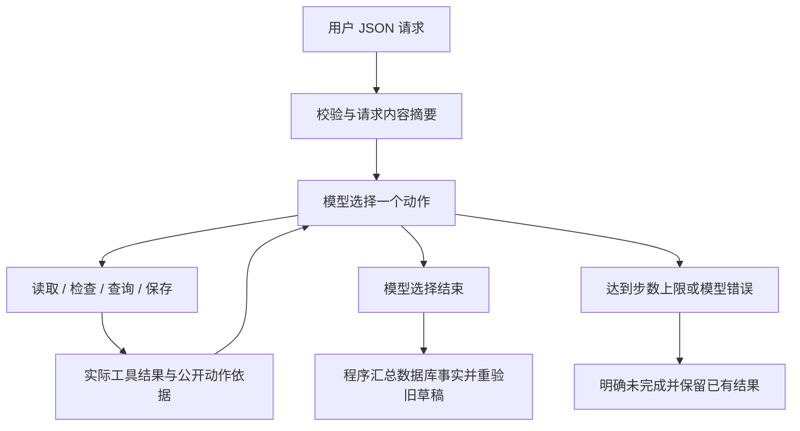

# 02 · 方案与技术取舍

## 最小调用流程

读取、审核、排期查询和草稿保存均为本地工具。ChatModel 使用原生 function calling：每次请求声明工具 schema；接收模型工具名/参数；执行后按 tool_call_id 把结果放回下次请求。每次最多一个动作，不进行后台自动重试。finish 只负责结束控制。

实时模式没有“如果冲突就固定调用替代查询”的程序分支；该选择由模型根据 query_slots 返回作出。离线 MockModel 则有固定策略，代码与输出明确标识 mock。程序中的固定分支负责字段、权限、风险和持久化约束，不能用来冒充模型决策。

## 两种实际路径

正常：read_material -> check_rules(approved) -> query_slots(available) -> save_draft(confirmed) -> finish。

冲突：read_material -> check_rules(approved) -> query_slots(unavailable) -> 模型补查 query_slots -> save_draft(pending,time_change) -> finish。

模型可在工具失败后选择一次重试或停止。在实际保存失败记录中，两次工具调用都返回失败，结果保持未保存，不把模型“已完成”措辞当成事实。

Trace 中 reason 是模型提供的简短公开动作依据，非内部思维；next_action 是下一次实际动作的名称，不是假定未来动作。每条记录保存完整合成工具观测和摘要，live 还保存服务响应 ID、实际模型版本、耗时和 token usage。

## 业务约束

- 时间：带时区输入，归一 UTC；演示时段按 UTC 整点、一小时粒度，同频道一个已确认草稿/已有排期占一个时段。不同频道独立。
- 审核：必要字段缺失 -> needs_input；版权明确未授权或禁用声明 -> blocked；带合作标签 -> needs_review。规则只覆盖结构化元数据，不审核视频像素/音轨。
- 硬性要求：原始请求摘要保存在 requests 表；模型只能提交 suggested_time，无法设置 confirmed。只有原要求、用户已确认替代时间或用户事先允许灵活时间，才可满足时间确认条件。
- 人工审核：人工标签始终要求人工确认，用户只确认时间不能绕过它；本项目不提供人工审核批准 API。
- 待确认建议：在同批内临时互斥，跨请求不预约。后续确认用新 request_id；旧草稿不会被静默覆盖。

## 保存与幂等

SQLite 唯一键 `(request_id, material_id)` 防止同请求重复保存。请求内容经时间归一、排序和 SHA-256 摘要，复用 ID 但内容不同时拒绝。相同草稿重复返回同一 ID；同请求改变建议时间返回 draft_immutable。

`BEGIN IMMEDIATE` 把冲突检查与插入放在同一写事务中；confirmed 部分唯一索引进一步保证同频道时段不会被两个请求同时占用。保存工具使用当前加载的业务资料再次审核；数据库占位实时查询。

最终输出还会对保存过的草稿进行安全重验：如果下一次执行的资料或排期快照已变化，历史保存事实仍保留，但有效确认状态改为 needs_revalidation，任务不能虚报完成。这个检查不替模型选择业务动作，而是确保输出真实。

## 状态和错误

审核、草稿保存、确认和发布四种状态分开。一个素材可“审核 approved + 草稿 saved + 确认 pending + 未发布”。保存失败即使已找到建议时段，draft_status 仍是 failed，待确认项和失败原因保留。

模型 HTTP/超时/畸形输出产生 model_error；非法工具或参数返回结构化工具错误并交回模型。默认 12 步，最高 100 步，单模型请求默认 45 秒超时。step_limit 或 model_error 强制整体 incomplete；已成功草稿仍显示真实 ID。没有业务自动重试或虚构补偿成功。

## 技术选择与职责

Python >=3.11 标准库负责 CLI、HTTP、JSON、SQLite 和测试；无 Agent 框架或第三方运行依赖。setuptools 只用于可选安装，不承担 Agent 决策。Chat Completions 原生工具调用负责模型动作生成，Python 循环负责工具路由、观测反馈、步数限制和记录。选择原生实现减少本题不必要的框架概念，不声称框架会提升得分。

接口实现依据 [OpenAI Function calling 官方文档](https://developers.openai.com/api/docs/guides/function-calling)，保持 assistant tool_calls -> tool response -> 下一轮模型请求的关系。其他兼容服务需自行验证 schema 和参数支持；不承诺所有“兼容 API”均可直接使用。

## 明确边界

JSON 文件每次 CLI 启动加载为业务快照；运行中修改磁盘文件不会自动热更新。并发保证覆盖同一 SQLite 数据库中的草稿，不覆盖多个数据库或外部发布系统。无身份认证，confirmations 代表本地操作者输入，不能用于生产授权。
